<p align="right"><a href="README.md">English</a> · <strong>한국어</strong></p>

<p align="center">
  
</p>

<h1 align="center">Python Image Preview</h1>

<p align="center">
  VS Code에서 Python을 디버깅하면서 배열, 텐서, 그래프를 이미지로 확인하세요.<br>
  브레이크포인트에 멈추면 변수 앞에 썸네일이 생성되고, <kbd>Ctrl</kbd>+<kbd>.</kbd>을 누르면 원본 크기로 열립니다.
</p>

<p align="center">
  <a href="https://marketplace.visualstudio.com/items?itemName=076923.python-image-preview">Marketplace</a> ·
  <a href="CHANGELOG.md">변경 이력</a> ·
  <a href="CONTRIBUTING.md">기여 안내</a>
</p>

---

## 소개

디버깅 중에 이미지가 올바르게 만들어졌는지 확인하려면 디버그 콘솔에 `plt.imshow(...)`를 입력하거나, 파일로 저장해서 따로 열어 확인해야 했습니다. 이 확장을 활용하면 그럴 필요가 없습니다. 브레이크포인트에 멈춘 상태에서 변수를 선택하면 PNG로 그려서 코드 옆에 띄워 줍니다. 소스 코드는 건드리지 않고, 디버깅이 끝나면 임시 파일도 함께 제거합니다.

## 빠른 시작

1. 확장을 설치합니다. 별도 설정은 없습니다. 이미지를 그릴 때는 디버깅 중인 Python 환경에 설치된 라이브러리를 그대로 사용합니다.
2. 이미지가 만들어진 다음 줄에 브레이크포인트를 걸고 <kbd>F5</kbd>로 디버깅을 시작합니다.
3. 멈추는 순간 **현재 함수 안의 이미지 변수 앞에 작은 썸네일**이 붙습니다. 썸네일에 마우스를 올리면 더 큰 이미지와 shape, dtype을 볼 수 있습니다.
4. 원본 크기로 보고 싶으면 변수에 커서를 두고 <kbd>Ctrl</kbd>+<kbd>.</kbd>(macOS는 <kbd>⌘</kbd>+<kbd>.</kbd>)을 누른 뒤 `[Matplotlib] Preview img` 같은 항목을 고릅니다. 코드 옆 탭에 이미지가 열립니다.

기본 사용법은 여기까지입니다. 아래에서 기능별로 자세히 설명합니다.

## 데모

<details>
<summary>데모 보기</summary>

| | |
| --- | --- |
| 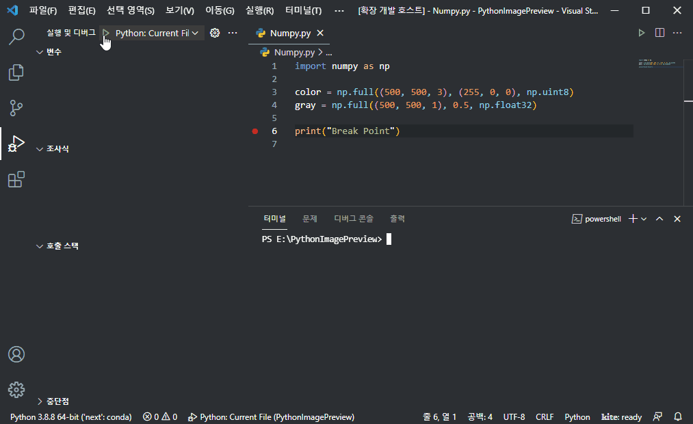 | 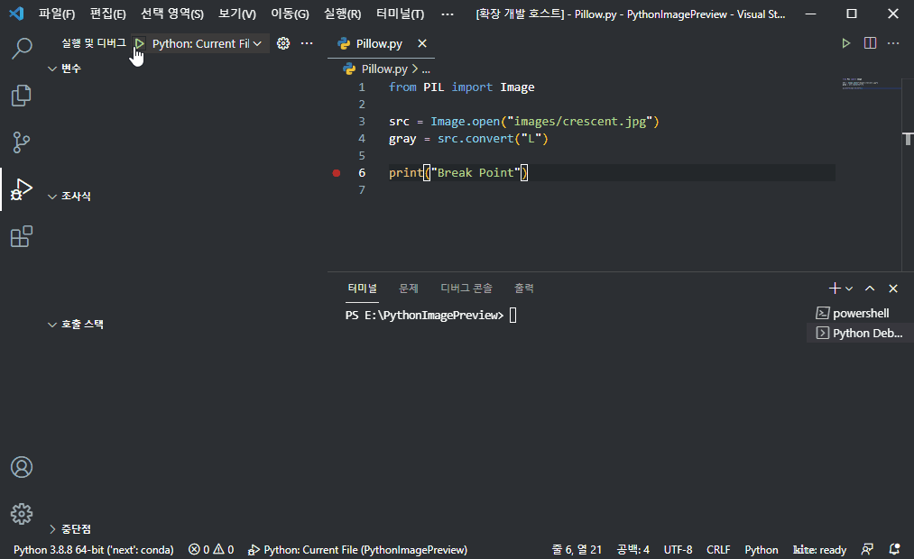 |
| 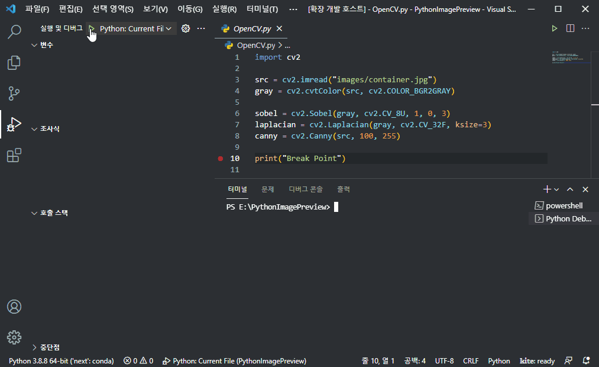 | 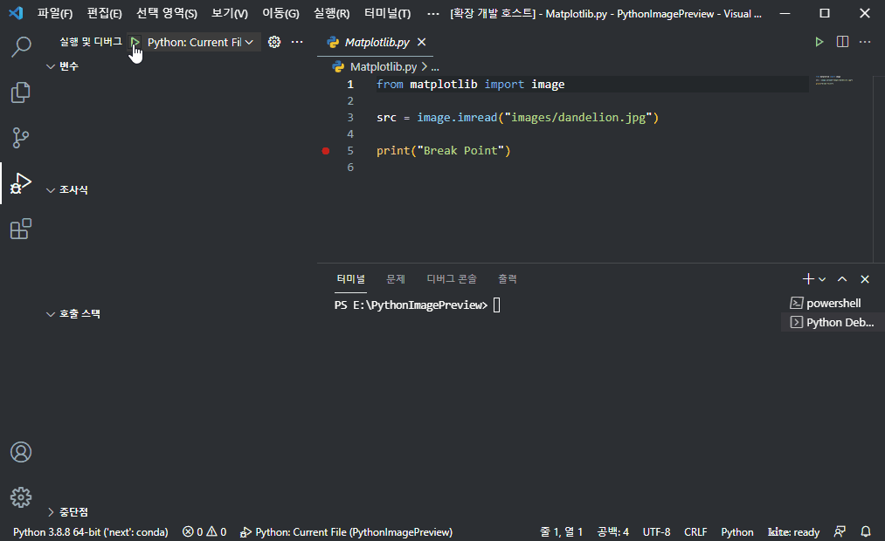 |
| 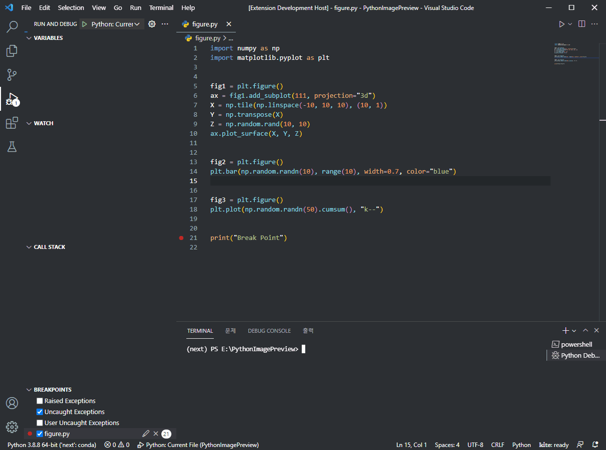 | 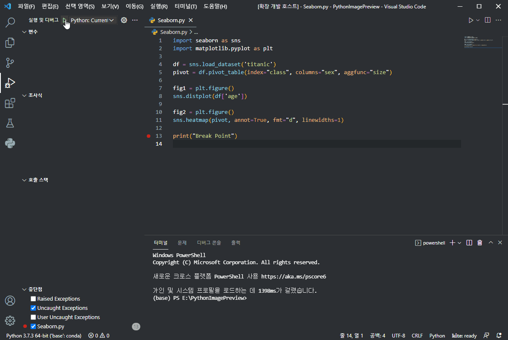 |
| 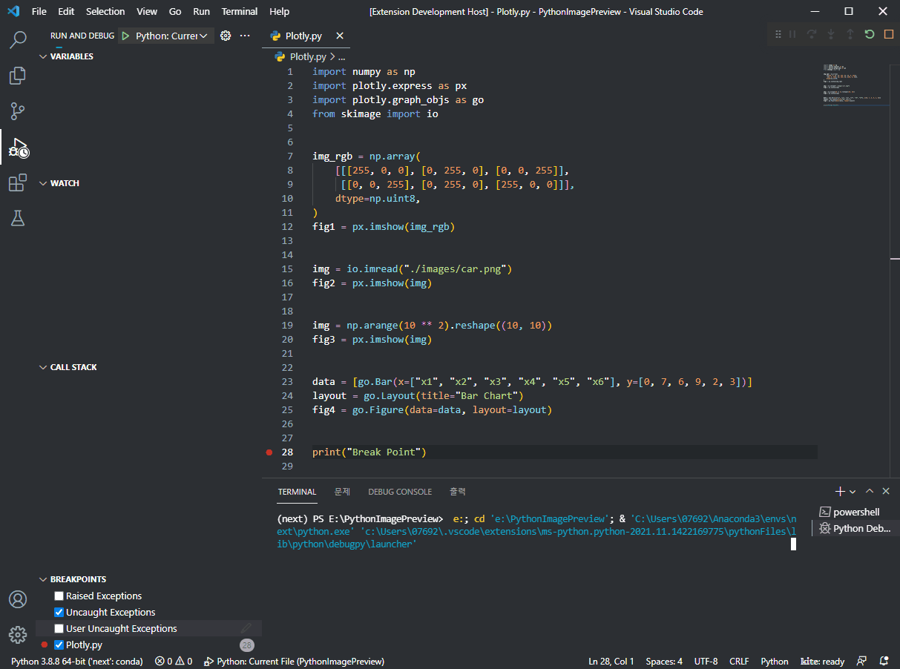 | 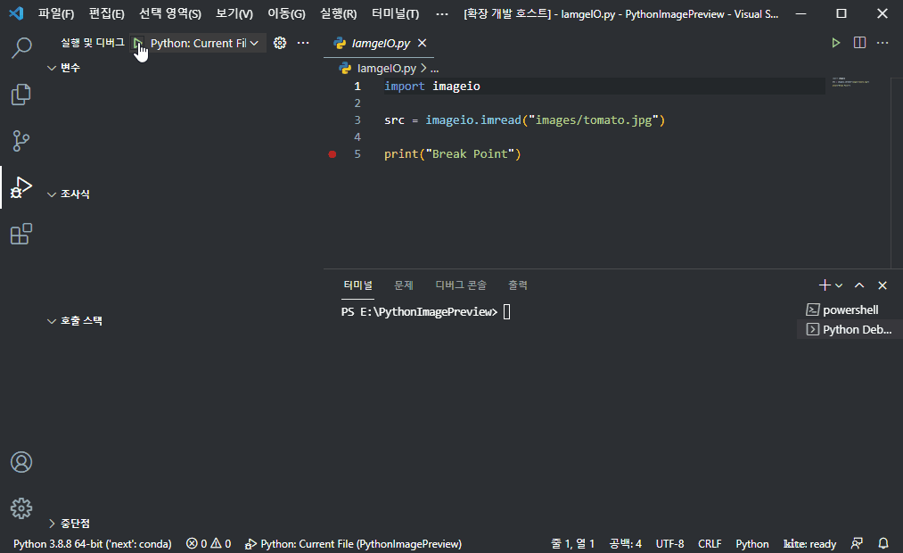 |
| 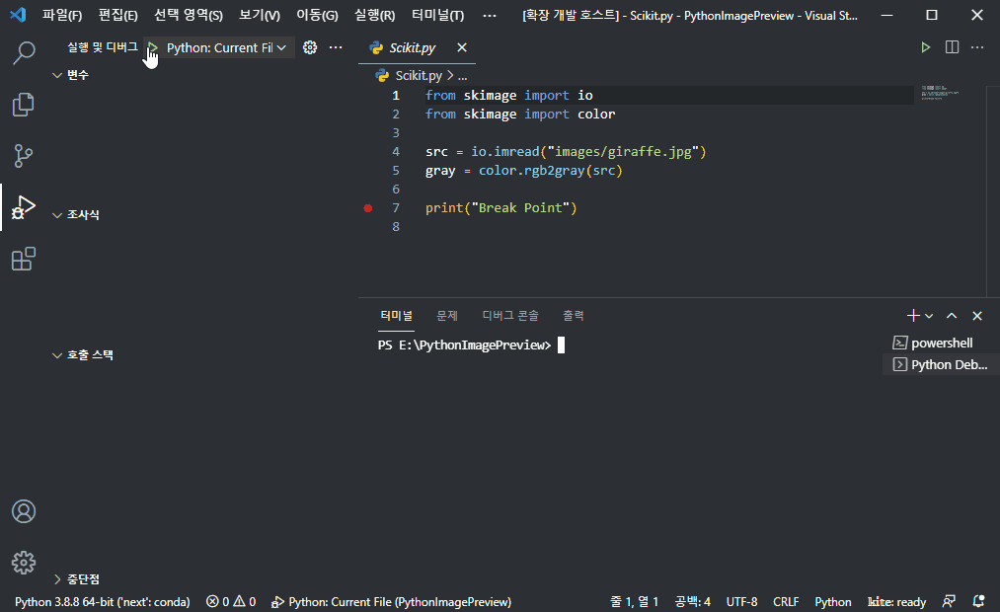 | 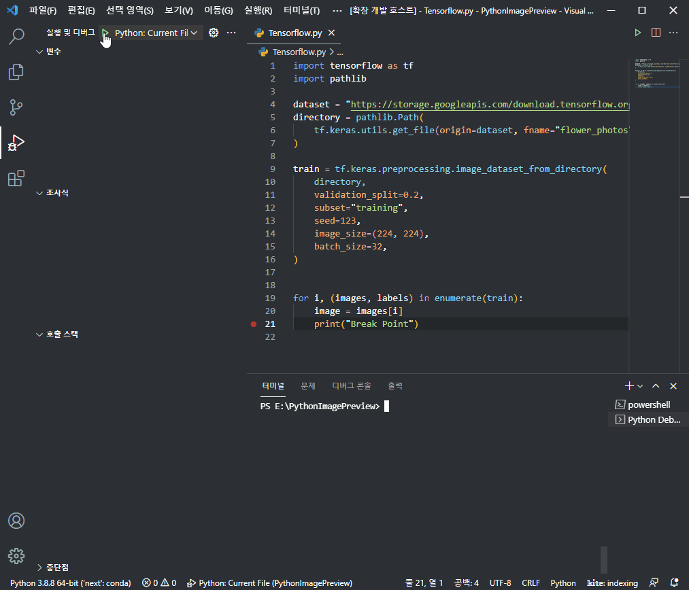 |
| 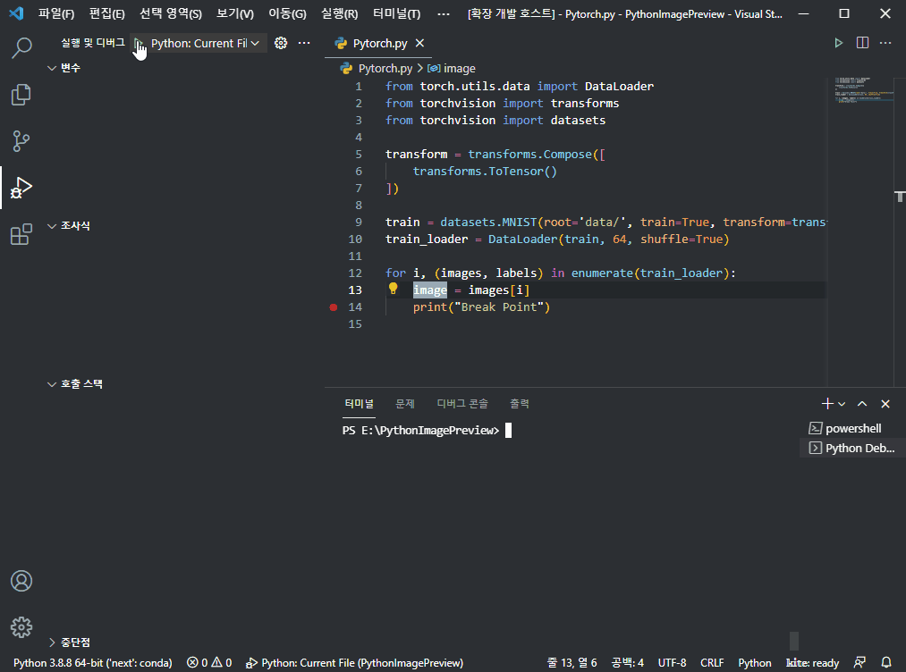 | |

</details>

## 기능별 사용법

### 코드 안에 붙는 썸네일

브레이크포인트에 멈춰 있는 동안, 이미지로 그릴 수 있는 로컬 변수에는 글자 한 줄 높이의 썸네일이 이름 바로 앞에 붙습니다. 그 변수가 나오는 줄마다 붙고, 스텝을 넘기면 새로 그려지며, 프로그램이 다시 실행되면 사라집니다.

- **썸네일에 마우스를 올리면** 큰 이미지와 함께 `img · ndarray (480, 640, 3) uint8`처럼 타입, shape, dtype이 표시되고 `OpenCV · Matplotlib` 같은 링크가 뜹니다. 링크를 누르면 원본 크기로 열립니다. 같은 팝업 위쪽에 디버거의 변수 값이 먼저 나오므로, 미리보기가 안 보이면 아래로 스크롤하거나 <kbd>Alt</kbd>를 눌러 미리보기만 보세요.
- 대상은 **현재 함수의 로컬 변수**(Locals)뿐이고, 디버거가 멈춘 파일에서만 보입니다. `self.img` 같은 속성에는 붙지 않으므로 Quick Fix나 호버를 이용하세요.
- 멈춘 줄에서 가까운 변수부터 그리고, 한 번 멈출 때 최대 `pythonImagePreview.inlineThumbnailLimit`개까지만 그립니다.
- 거슬리면 `pythonImagePreview.inlineThumbnails`를 꺼 두면 됩니다.

### 원본 크기로 보기 (Quick Fix)

1. `img`, `mask`, `self.image` 같은 변수 이름에 커서를 둡니다.
2. <kbd>Ctrl</kbd>+<kbd>.</kbd>(macOS는 <kbd>⌘</kbd>+<kbd>.</kbd>)을 누릅니다. 우클릭 메뉴의 **Preview Image at Cursor**를 고르거나 전구 아이콘을 눌러도 같습니다.
3. 렌더러를 고릅니다. 항목 앞의 이름이 이미지를 저장할 라이브러리입니다. `[OpenCV] Preview img`는 배열을 BGR로, `[Matplotlib] Preview img`는 RGB로 해석합니다.
4. 에디터 옆 칸에 PNG가 열립니다. 스텝을 넘긴 뒤 같은 작업을 반복하면 이미지가 갱신됩니다. 이전 결과와 나란히 비교하고 싶으면 `pythonImagePreview.keepHistory`를 켜세요. 매번 새 탭에 열립니다.

메뉴에는 디버깅 중인 인터프리터에서 import할 수 있는 라이브러리만 나옵니다. `[Matplotlib]`은 있는데 `[OpenCV]`가 없다면 그 환경에 `cv2`가 없는 것입니다. 항목을 고르기 전까지는 아무것도 그리지 않으므로 메뉴만 열어 보는 데는 부담이 없습니다.

### 변수가 아닌 표현식 보기

`batch[0]`, `img[..., 0]`, `self.model.weight`, `(x - 0.5) / 0.5`처럼 코드 일부를 드래그해서 선택하고 <kbd>Ctrl</kbd>+<kbd>.</kbd>을 누르세요. 선택한 식을 멈춘 프레임에서 계산해 변수와 똑같이 보여 줍니다. 한 줄짜리 식이어야 하고, 실행했을 때 부작용이 없는 식이어야 합니다.

### Variables 패널에서 보기

**실행 및 디버그 › Variables** 패널에서 변수를 우클릭하고 **Preview Image**를 고릅니다. 쓸 수 있는 렌더러가 여럿이면 선택창이 뜹니다. 리스트 원소나 객체 속성처럼 트리 안쪽 항목도 됩니다.

### Alt 누르고 호버

디버깅 중에 변수 이름에 마우스를 올리면 디버거가 값을 보여 주는 팝업이 먼저 뜹니다. 팝업이 뜬 상태에서 <kbd>Alt</kbd>(macOS는 <kbd>⌥</kbd>)를 누르거나, 처음부터 누른 채 올리면 이미지 미리보기 팝업으로 바뀝니다. 키를 떼면 원래 팝업으로 돌아옵니다. 내용은 썸네일 호버와 같습니다. 앞에 썸네일이 안 붙는 표현식이나 속성을 볼 때 쓰면 됩니다. 이 팝업은 Pylance 같은 다른 확장의 호버와 한 공간을 나눠 씁니다.

### 기준 프레임과 파일

위 기능은 모두 **호출 스택(Call Stack)** 뷰에서 선택한 프레임을 기준으로, 그 프레임이 속한 파일 안에서만 동작합니다. 다른 파일에 이름이 같은 변수가 있어도 다른 객체이므로 보여 주지 않습니다. 다른 프레임을 클릭하면 그 프레임의 변수를 볼 수 있고, 썸네일도 그 프레임의 파일과 로컬 변수로 바뀝니다. Variables 패널은 어떤 파일을 열어 두었든 상관없이 동작합니다.

### 인라인 값 (선택 사항)

VS Code는 멈춰 있는 동안 줄 끝에 변수 값을 보여 주는 기능이 있습니다(`debug.inlineValues`). 이 확장은 그 자리에 이미지 변수의 값을 `img: (480, 640, 3) uint8` 같은 짧은 요약으로 바꿔 넣을 수 있습니다. 기본은 꺼져 있고, `pythonImagePreview.inlineValues`를 `images`(이미지 변수만) 또는 `all`(모든 변수, 이미지 변수는 요약)로 바꾸면 켜집니다.

## 지원하는 객체

**Library**는 객체가 속한 라이브러리, **Renders with**는 PNG를 저장할 때 쓰는 pip 패키지입니다. 디버깅 중인 인터프리터에 설치된 것만 렌더러로 제공됩니다.

| Library | 객체 타입 | Renders with (pip) |
| --- | --- | --- |
| NumPy, imageio, scikit-image | `ndarray`, `memmap`, `MaskedArray` | `opencv-python` 또는 `matplotlib` |
| JAX, CuPy | `ArrayImpl`, `ndarray` | `opencv-python` 또는 `matplotlib` |
| Pillow | `Image`, `*ImageFile` | `pillow` |
| OpenCV | `ndarray` (BGR로 저장) | `opencv-python` |
| Matplotlib | `Figure`, `SubFigure`, `Axes` | `matplotlib` |
| Seaborn | `Axes`, `FacetGrid`, `PairGrid`, `JointGrid` | `matplotlib` |
| Plotly | `Figure` | `plotly` + `kaleido` |
| pandas | `DataFrame`, `Series` (`.plot()`으로 그림) | `pandas` + `matplotlib` |
| TensorFlow | `EagerTensor`, `ResourceVariable` | `pillow` |
| PyTorch | `Tensor`, `Parameter` (디바이스·grad 여부 무관) | `pillow` |
| SimpleITK | `Image` | `SimpleITK` + `pillow` |
| nibabel | `Nifti1Image`, `Nifti2Image`, `MGHImage`, … | `nibabel` + `pillow` |
| Bokeh | `figure`, `GridPlot`, `Row`, `Column` | `bokeh` + `selenium` 또는 `playwright` |
| Altair | `Chart`, `LayerChart`, `HConcatChart`, … | `altair` + `vl-convert-python` |

배열과 텐서는 저장하기 전에 자동으로 정리하므로 흔히 쓰는 형태는 그대로 보입니다.

- 맨 앞 배치 차원은 떼어 냅니다 (`N×C×H×W` → 첫 번째 항목)
- `C×H×W`는 `H×W×C`로 바꿉니다
- 마지막 차원이 1인 채널은 없앱니다
- `MaskedArray`의 마스크된 값과 `NaN`은 0으로 채웁니다
- 값은 `uint8`로 맞춥니다. `bool`은 0/255, `0..1` 범위는 255를 곱하고, `0..255` 범위는 그대로 두며, 그 밖의 범위(`uint16`, `-1..1` 텐서 등)는 min-max로 늘립니다
- `float16`, `bfloat16` 텐서는 먼저 `float32`로 바꿉니다
- 의료 영상 볼륨은 가운데 슬라이스를 min-max로 늘려 보여 줍니다

## 설정

| 설정 | 기본값 | 설명 |
| --- | --- | --- |
| `pythonImagePreview.cacheDirectory` | `""` | 미리보기 파일을 둘 폴더. 비워 두면 OS 임시 폴더를 씁니다. `${workspaceFolder}`, `${workspaceFolderBasename}`, `${fileDirname}`, `${fileBasenameNoExtension}`, `${userHome}`, `${tmpdir}`, `${env:NAME}`을 쓸 수 있습니다. |
| `pythonImagePreview.keepHistory` | `false` | 켜면 미리보기마다 새 파일로 저장해 각각 다른 탭에 열리므로 이전 결과와 비교할 수 있습니다. 끄면 변수마다 파일 하나를 덮어씁니다. |
| `pythonImagePreview.clearOnSessionEnd` | `true` | 디버그 세션이 끝나면 미리보기 파일을 지웁니다. |
| `pythonImagePreview.openBeside` | `true` | 미리보기를 현재 칸이 아니라 옆 칸에 엽니다. |
| `pythonImagePreview.grayscaleColormap` | `"gray"` | Matplotlib 렌더러로 2차원 배열을 그릴 때 쓸 컬러맵 (`gray`, `viridis`, `magma` 등). |
| `pythonImagePreview.hoverPreview` | `true` | <kbd>Alt</kbd>를 누른 채 이미지 변수에 마우스를 올리면 shape/dtype과 썸네일을 보여 줍니다. |
| `pythonImagePreview.hoverThumbnailWidth` | `320` | 호버 썸네일의 최대 너비(px). 비율을 유지한 채 줄입니다. |
| `pythonImagePreview.hoverThumbnailHeight` | `120` | 호버 썸네일의 최대 높이(px). |
| `pythonImagePreview.inlineThumbnails` | `true` | 이미지 로컬 변수 이름 앞에 작은 썸네일을 붙입니다. 마우스를 올리면 크게 볼 수 있습니다. |
| `pythonImagePreview.inlineThumbnailHeight` | `0` | 인라인 썸네일 높이(px). `0`이면 에디터 줄 높이에 맞춥니다. |
| `pythonImagePreview.inlineThumbnailLimit` | `40` | 한 번 멈출 때 썸네일로 그릴 변수 수. 멈춘 줄에서 가까운 것부터 그립니다. |
| `pythonImagePreview.inlineValues` | `"off"` | `images`: 이미지 로컬 변수만 `이름: shape dtype`으로 표시. `all`: 다른 변수도 VS Code 기본처럼 값을 표시. `off`: VS Code 기본 동작. `debug.inlineValues`가 `auto`나 `on`이어야 합니다. |

설정은 바꾸는 즉시 적용됩니다. `cacheDirectory`를 바꾸면 이전 폴더는 지웁니다.

예전 버전처럼 소스 파일 옆에 미리보기를 두고 싶으면:

```json
"pythonImagePreview.cacheDirectory": "${fileDirname}/__pycache__/preview"
```

## 명령

| 명령 | 설명 |
| --- | --- |
| `Python Image Preview: Preview Image at Cursor` | 쓸 수 있는 렌더러를 Quick Fix 메뉴로 보여 줍니다. |
| `Preview Image` (Variables 패널 우클릭) | 선택한 변수를 그립니다. 렌더러가 여럿이면 고르게 합니다. |
| `Python Image Preview: Open Settings` | 이 확장의 설정만 모아서 엽니다. |
| `Python Image Preview: Clear Preview Cache` | 지금까지 저장한 미리보기 파일을 모두 지웁니다. |

## 동작 방식

확장은 Debug Adapter Protocol로 `debugpy`와 통신합니다. 선택된 프레임에서 변수를 찾고, `importlib.util.find_spec`으로 어떤 라이브러리가 있는지 실제로 import하지 않고 확인합니다. 렌더러를 고르면 그 프레임 안에서 짧은 코드를 실행해 PNG를 저장합니다. 이 코드는 `try/except`로 감싸여 있고, Matplotlib 백엔드를 바꾸지 않으며, 끝나면 임시 변수를 지웁니다. 실패하면 원인을 **Python Image Preview** 출력 채널에 남깁니다.

workspace 확장으로 선언되어 있어서 Remote-SSH, WSL, Dev Containers에서는 Python 프로세스가 있는 원격 쪽에서 실행되고, 미리보기 파일도 그쪽에서 엽니다. 다른 컴퓨터의 디버거에 `attach`만 한 경우에는 PNG가 그 컴퓨터에 저장되므로 열리지 않습니다.

## 문제 해결

- **썸네일이 안 보여요.** 지금 보고 있는 파일에서 디버거가 멈춰 있어야 하고, 변수가 현재 함수의 로컬이어야 합니다. 함수 안에 멈춰 있으면 모듈 레벨 전역 변수에는 붙지 않습니다. 그려지다 실패한 경우는 **Python Image Preview** 출력 채널에 기록됩니다.
- **Quick Fix 메뉴가 안 떠요.** 세션이 멈춰 있어야 하고, 선택된 프레임이 멈춘 바로 그 파일이어야 하며, 변수가 그 프레임의 Locals나 Globals에 있어야 합니다. 단순 변수가 아니면 식을 선택하세요.
- **렌더러가 안 나와요.** 디버깅 중인 인터프리터에 그 라이브러리가 없는 경우입니다. 출력 채널에 어떤 모듈을 확인했는지 적혀 있습니다.
- **인라인 값이 하나도 안 보여요.** `debug.inlineValues`를 `auto`나 `on`으로 두세요. VS Code와 마찬가지로 Locals만 봅니다.
- **일반 변수의 인라인 값이 사라졌어요.** `images` 모드에서는 그렇습니다. `pythonImagePreview.inlineValues`를 `all`로 바꾸면 함께 보이고(모듈, 함수, 클래스는 계속 숨김), `off`로 두면 VS Code 기본으로 돌아갑니다.
- **호버에 썸네일 대신 값만 나와요.** 그건 디버거의 호버입니다. 이름 앞 썸네일에 마우스를 올리거나, <kbd>Alt</kbd>(macOS는 <kbd>⌥</kbd>)를 누른 채 이름에 올리세요. <kbd>Alt</kbd> 호버는 Pylance 같은 다른 확장의 호버와 팝업을 나눠 쓰므로, 스크롤이 생기면 `pythonImagePreview.hoverThumbnailHeight`를 낮추세요.
- **렌더링에 실패해요.** 오류 메시지의 **Show Log**를 누르면 Python 예외를 출력 채널에서 볼 수 있습니다.
- **Plotly / Bokeh / Altair가 안 돼요.** 각 라이브러리의 이미지 내보내기 백엔드(`kaleido`, `selenium`/`playwright`, `vl-convert-python`)가 필요합니다.

## 라이선스

독점 라이선스입니다. 개인·상업 용도 모두 무료로 쓸 수 있지만 재배포와 수정은 할 수 없습니다. 자세한 내용은 [LICENSE.md](LICENSE.md)를 보세요.

## 만든 사람

윤대희 · s076923@gmail.com
