<p align="right"><strong>English</strong> · <a href="README.ko.md">한국어</a></p>

<p align="center">
  
</p>

<h1 align="center">Python Image Preview</h1>

<p align="center">
  See arrays, tensors and figures while you debug Python in VS Code.<br>
  Thumbnails appear next to your variables when the debugger pauses; press <kbd>Ctrl</kbd>+<kbd>.</kbd> for the full picture.
</p>

<p align="center">
  <a href="https://marketplace.visualstudio.com/items?itemName=076923.python-image-preview">Marketplace</a> ·
  <a href="CHANGELOG.md">Changelog</a> ·
  <a href="CONTRIBUTING.md">Contributing</a>
</p>

---

## Why

Inspecting image data in a debugger usually means typing `plt.imshow(...)` into the console or dumping files by hand. This extension does that for you: while the debugger is paused it renders the variable under the cursor to a PNG and opens it beside your code. Nothing is added to your source and nothing stays behind after the session.

## Quick start

1. Install the extension. There is nothing to configure; the libraries used for rendering are the ones already installed in the Python environment you debug.
2. Open a Python file, set a breakpoint after an image has been created, and start debugging (<kbd>F5</kbd>).
3. When the debugger pauses, a **small thumbnail appears in front of every image-like variable of the current function**. Hover it to see the image larger, together with its shape and dtype.
4. For the full-size picture, put the cursor on the variable and press <kbd>Ctrl</kbd>+<kbd>.</kbd> (macOS <kbd>⌘</kbd>+<kbd>.</kbd>), then choose `[Matplotlib] Preview img` or another renderer. The image opens in an editor tab next to your code.

That is all there is to it. The sections below describe each way of looking at an image in more detail.

## Demos

<details>
<summary>Show demos</summary>

| | |
| --- | --- |
| 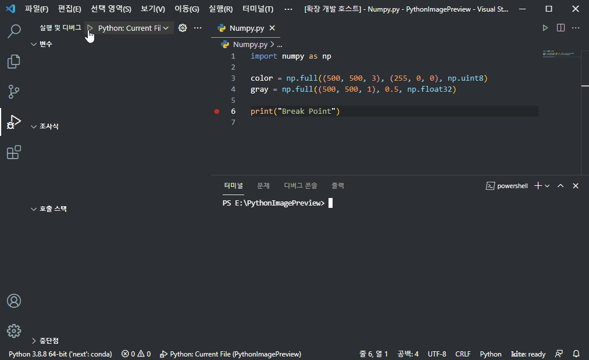 | 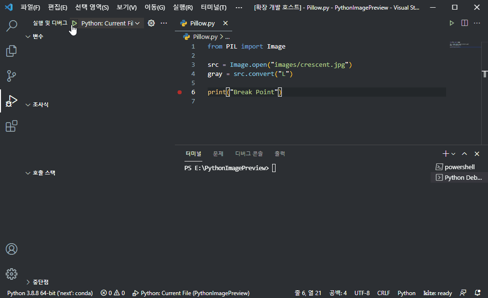 |
| 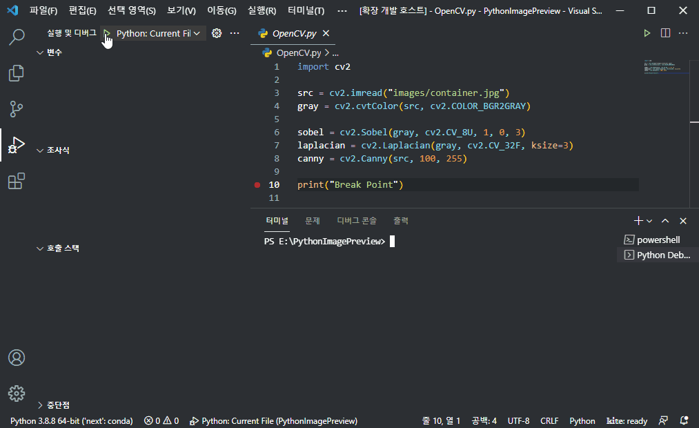 | 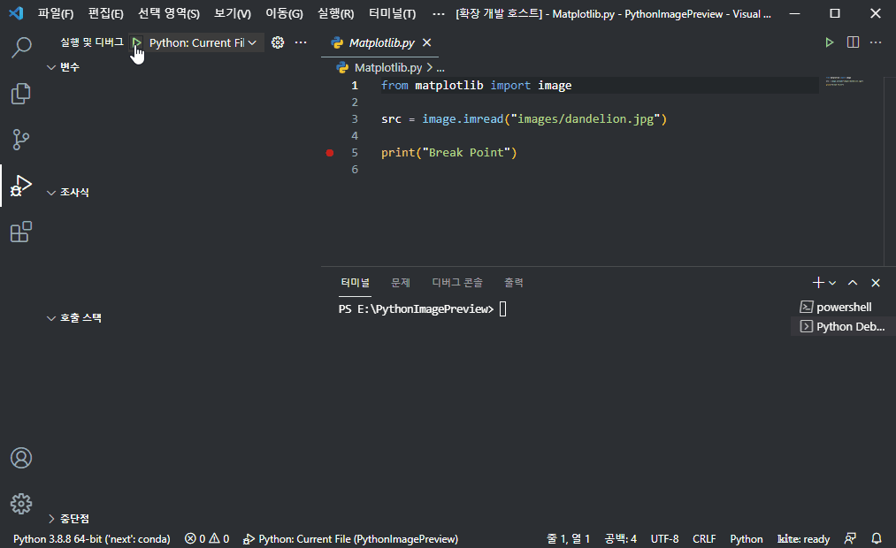 |
| 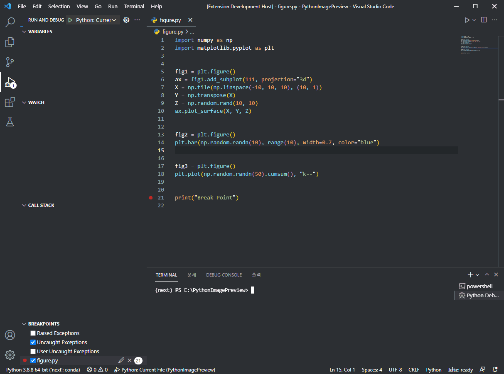 | 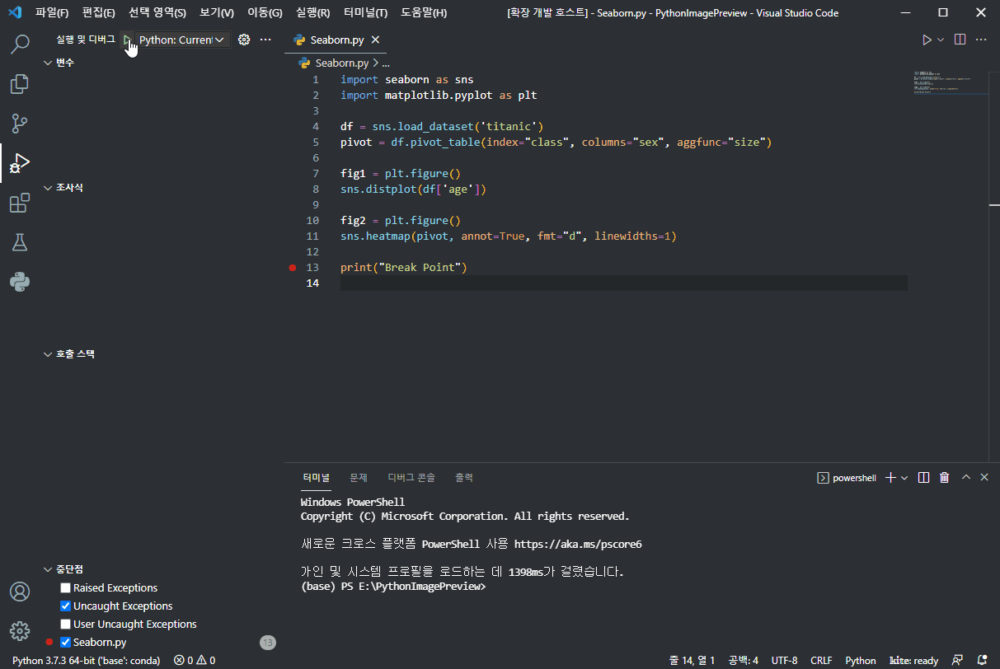 |
| 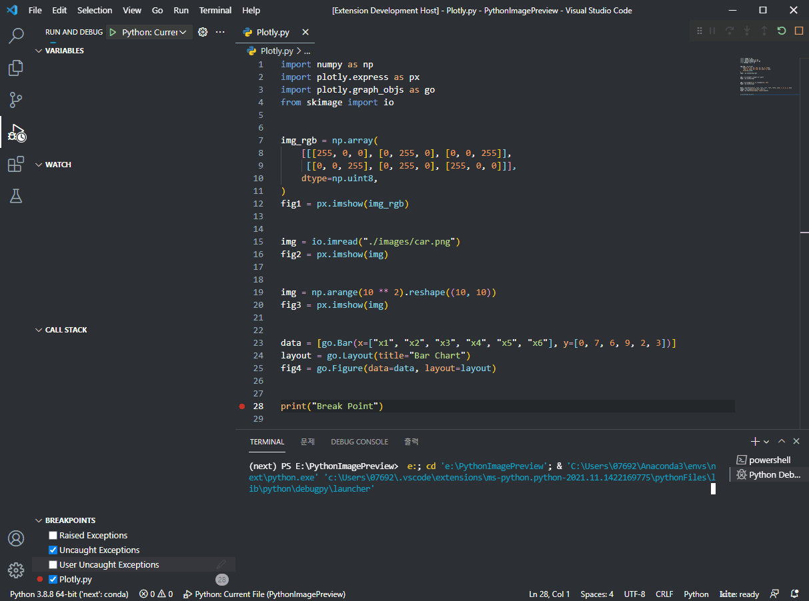 | 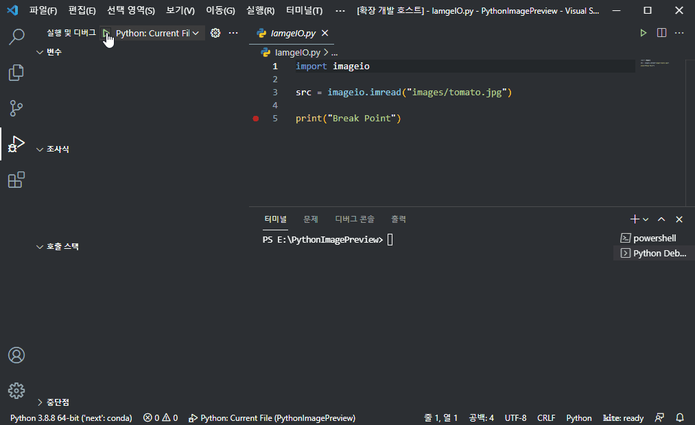 |
| 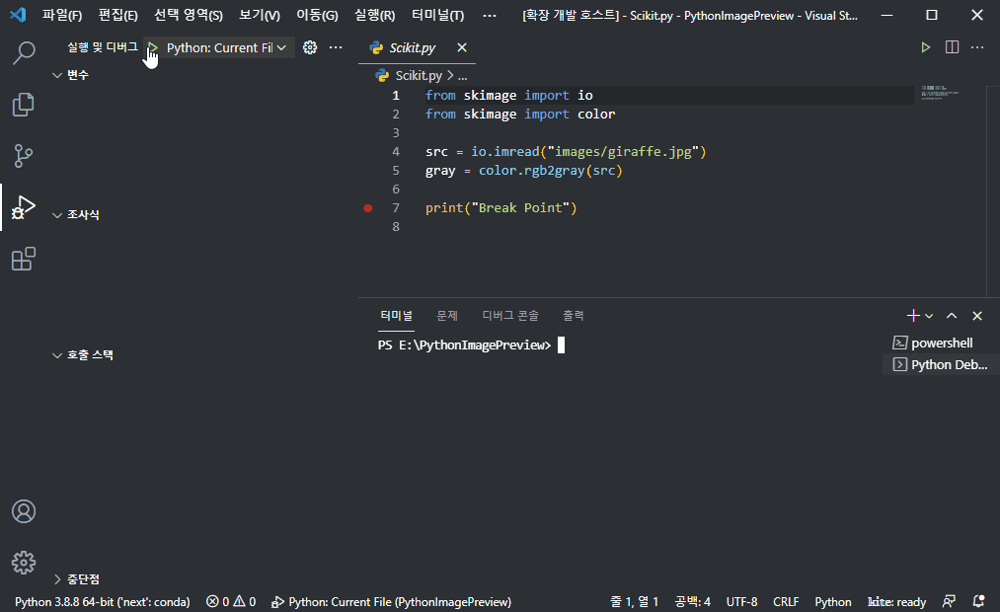 | 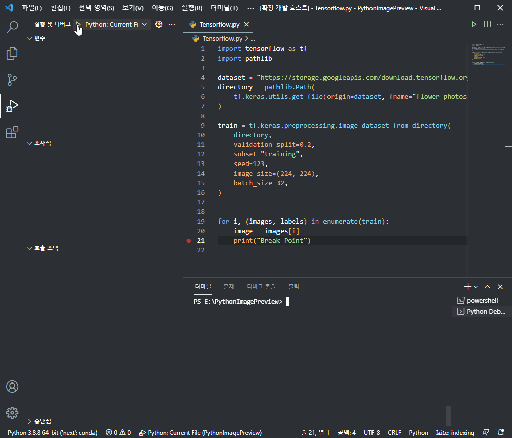 |
| 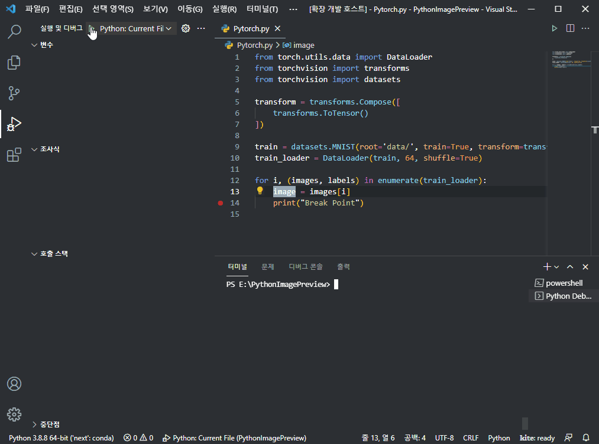 | |

</details>

## Ways to preview

### Thumbnails in the code

While the debugger is paused, every local variable that can be rendered as an image gets a thumbnail the height of one text line, placed right before its name on every line that mentions it. They update when you step and disappear when the program runs on.

- **Hover a thumbnail** to see a larger version with the variable's type, shape and dtype, for example `img · ndarray (480, 640, 3) uint8`, and links such as `OpenCV · Matplotlib`. Click a link to open the full-size image. The debugger's own value popup opens in the same tooltip above it; scroll down, or press <kbd>Alt</kbd> to show only the preview.
- Only variables of the **current function** (the Locals scope) are shown, and only in the file the debugger is paused in. Attributes such as `self.img` are not decorated; use the Quick Fix or the hover for those.
- Variables mentioned closest to the paused line are rendered first, up to `pythonImagePreview.inlineThumbnailLimit` variables per stop.
- Turn this off with `pythonImagePreview.inlineThumbnails` if it gets in the way.

### Full-size preview (Quick Fix)

1. Place the cursor on a variable name, for example `img`, `mask` or `self.image`.
2. Press <kbd>Ctrl</kbd>+<kbd>.</kbd> (macOS <kbd>⌘</kbd>+<kbd>.</kbd>). Alternatively right-click and choose **Preview Image at Cursor**, or click the light bulb.
3. Pick a renderer. Each entry is labelled with the library that will write the image, e.g. `[OpenCV] Preview img` treats the array as BGR, `[Matplotlib] Preview img` as RGB.
4. The PNG opens in the column beside the editor. Run the same steps again after stepping to refresh it, or turn on `pythonImagePreview.keepHistory` to keep every version in its own tab and compare them side by side.

Only renderers whose library can be imported in the debugged interpreter are offered. If you see `[Matplotlib]` but not `[OpenCV]`, `cv2` is not installed in that environment. Nothing is rendered until you pick an entry, so opening the menu is cheap.

### Any expression, not only variables

Select a piece of code, for example `batch[0]`, `img[..., 0]`, `self.model.weight` or `(x - 0.5) / 0.5`, and press <kbd>Ctrl</kbd>+<kbd>.</kbd>. The selection is evaluated in the paused frame and previewed like a variable. The selection has to be a single-line expression without side effects you would not want to run.

### From the Variables view

Right-click a variable in the **Run and Debug › Variables** panel and choose **Preview Image**. If several renderers apply, a picker asks which one to use. This also works for nested entries such as items of a list or attributes of an object.

### Hover with Alt

Hovering a variable name while debugging shows the debugger's own value popup. Press <kbd>Alt</kbd> (<kbd>⌥</kbd> on macOS) while the popup is open, or hold it while hovering, and it switches to the image preview popup with the same thumbnail and links as the thumbnail hover; release the key to go back. This is useful for expressions and attributes that have no thumbnail in front of them. Other extensions' hovers (for example Pylance's type information) share this popup.

### Which frame and file are used

Everything above works on the frame selected in the **Call Stack** view, and only in the file that frame belongs to. A variable with the same name in another open file is not shown, since it would be a different object. Click another frame to inspect its variables; the thumbnails switch to that frame's file and locals. The Variables view works regardless of which file is open.

### Inline values (optional)

VS Code can show variable values at the end of lines while paused (`debug.inlineValues`). The extension can replace those values with a compact `img: (480, 640, 3) uint8` for image-like variables. This is off by default; set `pythonImagePreview.inlineValues` to `images` (image-like variables only) or `all` (every variable, image-like ones summarised).

## Supported objects

The **Library** column is the library the object comes from; **Renders with** lists the pip packages the extension uses to write the PNG. Only renderers that are importable in the debugged interpreter are offered.

| Library | Object types | Renders with (pip) |
| --- | --- | --- |
| NumPy, imageio, scikit-image | `ndarray`, `memmap`, `MaskedArray` | `opencv-python` or `matplotlib` |
| JAX, CuPy | `ArrayImpl`, `ndarray` | `opencv-python` or `matplotlib` |
| Pillow | `Image`, `*ImageFile` | `pillow` |
| OpenCV | `ndarray` (written as BGR) | `opencv-python` |
| Matplotlib | `Figure`, `SubFigure`, `Axes` | `matplotlib` |
| Seaborn | `Axes`, `FacetGrid`, `PairGrid`, `JointGrid` | `matplotlib` |
| Plotly | `Figure` | `plotly` + `kaleido` |
| pandas | `DataFrame`, `Series` (via `.plot()`) | `pandas` + `matplotlib` |
| TensorFlow | `EagerTensor`, `ResourceVariable` | `pillow` |
| PyTorch | `Tensor`, `Parameter` (any device, with or without grad) | `pillow` |
| SimpleITK | `Image` | `SimpleITK` + `pillow` |
| nibabel | `Nifti1Image`, `Nifti2Image`, `MGHImage`, … | `nibabel` + `pillow` |
| Bokeh | `figure`, `GridPlot`, `Row`, `Column` | `bokeh` + `selenium` or `playwright` |
| Altair | `Chart`, `LayerChart`, `HConcatChart`, … | `altair` + `vl-convert-python` |

Arrays and tensors are normalized before saving, so the common shapes just work:

- a leading batch dimension is dropped (`N×C×H×W` → first item)
- `C×H×W` is transposed to `H×W×C`
- a trailing single channel is squeezed
- masked entries of a `MaskedArray` are filled with 0, `NaN` becomes 0
- values are mapped to `uint8`: `bool` → 0/255, `0..1` is scaled by 255, `0..255` is kept, anything else (`uint16`, `-1..1` tensors, …) is min-max scaled
- half-precision tensors (`float16`, `bfloat16`) are widened before conversion
- medical volumes show the middle slice, min-max scaled

## Settings

| Setting | Default | Description |
| --- | --- | --- |
| `pythonImagePreview.cacheDirectory` | `""` | Folder for preview files. Empty uses the OS temp directory. Supports `${workspaceFolder}`, `${workspaceFolderBasename}`, `${fileDirname}`, `${fileBasenameNoExtension}`, `${userHome}`, `${tmpdir}` and `${env:NAME}`. |
| `pythonImagePreview.keepHistory` | `false` | Write every preview to a new file so each opens in its own tab and earlier ones stay open for comparison. Off: a variable reuses one file. |
| `pythonImagePreview.clearOnSessionEnd` | `true` | Delete preview files when the debug session ends. |
| `pythonImagePreview.openBeside` | `true` | Open previews beside the editor instead of in the active column. |
| `pythonImagePreview.grayscaleColormap` | `"gray"` | Matplotlib colormap for 2-D arrays rendered with the Matplotlib renderer (`gray`, `viridis`, `magma`, …). |
| `pythonImagePreview.hoverPreview` | `true` | Show shape/dtype and a thumbnail when hovering an image-like variable with <kbd>Alt</kbd> held. |
| `pythonImagePreview.hoverThumbnailWidth` | `320` | Maximum width of the hover thumbnail in pixels; the image is scaled down to fit, keeping its aspect ratio. |
| `pythonImagePreview.hoverThumbnailHeight` | `120` | Maximum height of the hover thumbnail in pixels. |
| `pythonImagePreview.inlineThumbnails` | `true` | Show a small thumbnail before each mention of an image-like local variable; hover it for the larger preview. |
| `pythonImagePreview.inlineThumbnailHeight` | `0` | Height of the inline thumbnail in pixels; `0` follows the editor's line height. |
| `pythonImagePreview.inlineThumbnailLimit` | `40` | Variables rendered as inline thumbnails per stop, nearest to the paused line first. |
| `pythonImagePreview.inlineValues` | `"off"` | `images`: `name: shape dtype` for image-like local variables only. `all`: other variables show their value too, as VS Code normally does. `off`: leave inline values to VS Code. Needs `debug.inlineValues` set to `auto` or `on`. |

Changes apply immediately. Switching `cacheDirectory` removes the folder used before.

To keep previews next to the source file, as earlier versions did:

```json
"pythonImagePreview.cacheDirectory": "${fileDirname}/__pycache__/preview"
```

## Commands

| Command | Description |
| --- | --- |
| `Python Image Preview: Preview Image at Cursor` | Opens the Quick Fix menu with the available renderers. |
| `Preview Image` (Variables view context menu) | Renders the selected variable, asking which renderer to use if several apply. |
| `Python Image Preview: Open Settings` | Opens the Settings editor filtered to this extension. |
| `Python Image Preview: Clear Preview Cache` | Deletes every preview file written so far. |

## How it works

The extension talks to the running debug adapter (`debugpy`) over the Debug Adapter Protocol. It looks the variable up in the selected frame and checks which libraries are importable there with `importlib.util.find_spec`, without importing them. When you pick a renderer it evaluates a small snippet in that frame which writes a PNG with the chosen library. The snippet runs inside a `try/except`, never touches the Matplotlib backend, and cleans up its temporaries. If rendering fails, the reason is logged to the **Python Image Preview** output channel.

The extension is declared as a workspace extension, so with Remote-SSH, WSL or Dev Containers it runs on the remote side next to the Python process and the preview file is opened from there. A bare `attach` to a debugger on another host does not work, because the PNG is written on that host.

## Troubleshooting

- **No thumbnails appear.** The debugger must be paused in the file you are looking at, and the variable must be a local of the current function (module-level globals are not decorated when paused inside a function). Check the **Python Image Preview** output channel for rendering errors.
- **No quick fix appears.** The session must be paused, the file must be the one the selected frame is paused in, and the variable must be visible in that frame's Locals or Globals. Select the expression if it is not a plain variable.
- **A renderer is missing.** The library is not importable in the debugged interpreter. The output channel lists which modules were probed.
- **No inline values at all.** Set `debug.inlineValues` to `auto` or `on`. Like VS Code itself, the extension only looks at the Locals scope.
- **Plain variables lost their inline values.** That happens in the `images` mode. Set `pythonImagePreview.inlineValues` to `all` to show them as well (modules, functions and classes stay hidden), or to `off` to hand inline values back to VS Code.
- **The hover shows the plain value, not a thumbnail.** That is the debugger's hover. Hover the thumbnail icon before the name instead, or hold <kbd>Alt</kbd> (<kbd>⌥</kbd> on macOS) while hovering the name. With <kbd>Alt</kbd>, other extensions' hovers (Pylance's type line, for example) share the popup; lower `pythonImagePreview.hoverThumbnailHeight` if it needs scrolling.
- **Rendering fails.** The error message offers **Show Log**; the Python exception is in the output channel.
- **Plotly / Bokeh / Altair.** These need their own export backends (`kaleido`, `selenium`/`playwright`, `vl-convert-python`).

## License

Proprietary. Free for personal and commercial use; redistribution and modification are not permitted. See [LICENSE.md](LICENSE.md).

## Author

Daehee Yun · s076923@gmail.com
